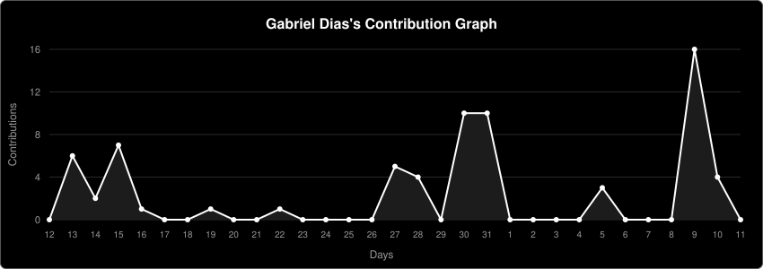

## About me

Hi, I'm **Gabriel**. Graduated IT technician (Senac MG) who builds tools that solve real problems, mostly backend, desktop apps, and Linux tinkering. Heading into a Software Engineering degree.

  
  
  

## Things I've made

- **[Pauca](https://cattastudios.com.br/pauca/)**: a minimalist Android launcher that makes your phone a little quieter.
- **[OpenAlt](https://cattastudios.com.br/openalt/)**: use your phone or tablet as an extra monitor or PC display mirror.
- **[Linux Wallpaper Engine](https://github.com/berelels/linux-wallpaper-engine-gnome-xorg)**: runs animated Steam Workshop wallpapers natively on GNOME/X11. Bash.
- **[Lydia](https://cattastudios.com.br/lydia-releases/)**: a workstation at the top of your screen, a dynamic island for Linux.

## Technologies

  
  
  
  
  
  
  
  
  
  
  
  
  
  

Comfortable reading and tweaking:

  
  
  

## Statistics

  

## Off the keyboard

Guitar and ukulele, football stats, Hollow Knight and Pokémon.
